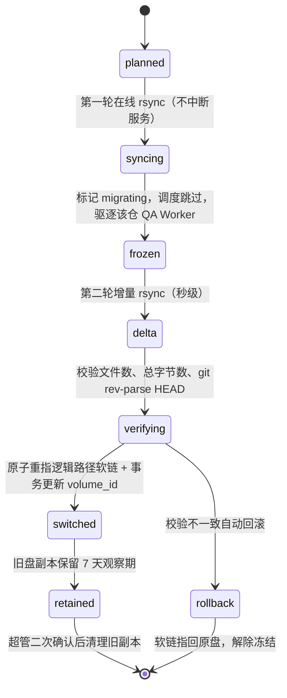
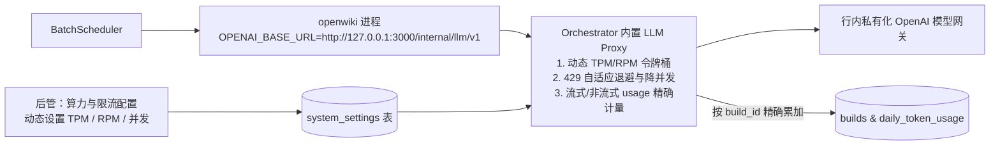

# 全行 633 仓基线批跑、多盘存储与组长权限体系实施计划（V8 终审定稿版）

> **For agentic workers:** REQUIRED SUB-SKILL: Use superpowers:subagent-driven-development (recommended) or superpowers:executing-plans to implement this plan task-by-task. Steps use checkbox (`- [ ]`) syntax for tracking.

> 📚 **计划版本演进历史（点击可查看各版本完整快照）：**
> - [V1 初始草案 (2026-10-29)](2026-10-29-openwiki-batch-scheduler-v1.md)：全行 500+ 代码库基线批量导入、Token 漏桶限流与夜间窗口批跑
> - [V2 动态并发与ETA版 (2026-10-29)](2026-10-29-openwiki-batch-scheduler-v2.md)：运行时并发热调整、实时进度与 ETA 预估、飞书多维表格同步
> - [V3 生产级加固版 (2026-10-29)](2026-10-29-openwiki-batch-scheduler-v3.md)：统一构建流水线、真实 Token 采集（方案 A）、基于条件变量的并发热缩放
> - [V4 633仓多盘硬挂载版 (2026-11-03)](2026-11-03-openwiki-batch-scheduler-v4.md)：四级防打穿熔断机制、633 仓容量测算（>=1.2TB）、多磁盘硬挂载与跨盘软链聚合、主备云盘自动漂移 HA
> - [V5 纯deploy零侵入版 (2026-11-03)](2026-11-03-openwiki-batch-scheduler-v5.md)：确定 OpenWiki 源码零修改原则、独立 TPM 令牌桶设计、实时静态页面落盘 disk0/static 托管
> - [V6 独立日志盘版 (2026-11-03)](2026-11-03-openwiki-batch-scheduler-v6.md)：日志剥离出 disk0 独立挂载 disk_log 盘、级联故障物理隔离、logrotate 自动滚存与安全清理
> - [V7 私有云修正版 (2026-11-03)](2026-11-03-openwiki-batch-scheduler-v7.md)：行内私有云独立虚机环境适配、持久化映射 + 加权最少负载放置算法、单仓 7 态在线平滑迁移、RBAC 组长业务域授权
> - **[V8 终审定稿版 (当前生效)](2026-11-03-openwiki-batch-scheduler-v8.md)**：只改 deploy、内置 OpenAI 兼容网关与后管动态配置 TPM/RPM、按业务域授权组长管理虚拟 Monorepo、单机可靠性保障（本期不做双机 HA）

**Goal:** 在**只改 `deploy/`、不改 OpenWiki 源码**的前提下，支撑全行 633 个仓库的基线批跑与日常运维，具体包括：
- **本地透明 LLM Gateway（OpenAI 兼容协议）**：实现真实 Token 采集、429 自适应退避与**后管可动态配置的 TPM / RPM 限流**；
- **多盘硬挂载存储与独立日志盘**：基于容量与负载加权算法均衡放置、支持在线平滑迁移与回滚；
- **业务聚合多仓（Virtual Monorepo）跨盘软链**：后台可视化配置、软链拓扑预览与断链巡检修复；
- **按业务域授权的组长权限体系（RBAC）**：基于行内 LDAP 认证，超管给组长按业务域授权自治管理；
- **单机可靠性保障**：SQLite `WAL + synchronous=FULL`、进程重启断点续跑恢复与定时备份（本期不引入双机 HA）。

**已确认边界与前提：**
1. **部署形态**：行内私有云单台独立虚拟机 + 多块本地硬挂载数据盘，不能挂共享存储，**本期暂不考虑双机 HA**（仅做单机崩溃恢复与定时备份）。
2. **大模型协议与限流**：行内私有化 **OpenAI 兼容协议**；因上游网关真实 TPM / RPM 配额未知，**在后管提供 TPM / RPM 动态配置项**（填 `0` 表示不设前置静态上限，仅靠 429 自适应退避；填写具体数值则启用令牌桶前置限流），并在后管展示实时实际吞吐与 429 曲线以便管理员调优。
3. **权限粒度**：组长（`group_leader`）统一**按业务域（`business_domain`）授权**。

**Tech Stack:** Go（Unit 1 Orchestrator / Unit 2 Portal / 内嵌或独立 LLM Gateway）、SQLite（WAL + FULL Sync）、Vanilla JS、Linux 本地多盘挂载。

---

## 0. 版本收敛对照表

| # | 议题 | 最终锁定方案 |
| :--- | :--- | :--- |
| 1 | 源码零侵入 | Revert `src/` 与 `test/` 改动；通过注入 `OPENAI_BASE_URL` / `OPENAI_COMPATIBLE_BASE_URL` 指向 `deploy` 内的本地 LLM Gateway |
| 2 | TPM / RPM 限流 | 仅实现 OpenAI 兼容协议网关；**TPM / RPM 阈值做成后管动态配置项（持久化在 SQLite `system_settings` 表）** + 429 自适应退避降并发 |
| 3 | 高可用（HA） | **本期不做双机 HA / DRBD / Pacemaker**；保留单机可靠性（`synchronous=FULL` + 启动重置 `running -> pending` + 定时备份） |
| 4 | 多盘均衡算法 | 不用令牌环/一致性哈希；采用**持久化映射（`repos.volume_id`）+ 容量与活跃构建加权最少负载放置** |
| 5 | 历史数据迁移 | 引入逻辑路径软链层 `/data/openwiki/repos/<id>` + 单仓 7 态在线迁移状态机 |
| 6 | 权限体系 | 三级角色：`super_admin`（全局）、`group_leader`（**按 `business_domain` 授权**）、`member`（只读浏览与问答） |

---

## 1. 目标存储拓扑（单机多盘硬挂载）

### 1.1 磁盘规划

| 挂载点 | 规格（初始建议） | 承载内容 | 说明 |
| :--- | :--- | :--- | :--- |
| `/data/disk0` | 200GB SSD | `db/`（SQLite）、`static/`（633 仓可视化静态页，约 30GB）、`projects/`（虚拟 Monorepo 工作区）、`links/repos/`（逻辑路径软链层） | 高频读与元数据盘，与仓库重度写 I/O 隔离 |
| `/data/disk_log` | 100~200GB | `app/`、`builds/<batch_id>/`、`archive/`；挂载参数 `noatime` | **独立日志盘**，写满绝不波及数据库；可安全快速清理 |
| `/data/vol1..volN` | 每块 500GB SSD（可随时加盘） | `repos/<repo_id>/`：源码、`.git`、`openwiki/` 文档、`.openwiki/` 状态 | 仓库物理存储池，由放置算法自动均衡分配 |

> **Task 11 Step 1 实测校准**：先抽样 20 个代表仓库实测 `du`（源码 + `.git` + `openwiki` 产物 + `static` 产物），校准单仓均值与峰值。

### 1.2 稳定路径间接层（Stable Path Indirection）

所有对外引用的仓库路径固定为**逻辑路径**，物理位置通过软链解析：

```
/data/disk0/links/repos/<repo_id>  ──symlink──►  /data/vol2/repos/<repo_id>
        ▲  (repos.local_path 永远存逻辑路径)             ▲ (repos.volume_id = vol2)
        │
/data/disk0/projects/<project_id>/<alias>  ──symlink──►  /data/disk0/links/repos/<repo_id>
```

- `repos.local_path`、项目工作区软链、QA Worker 的 cwd，统一使用逻辑路径。
- **跨盘迁移仓库只需原子重指逻辑路径软链**（`ln -sfn` 临时链 + `os.Rename`），数据库路径与所有项目软链均无需改动。

---

## 2. 多盘均衡放置与在线再均衡算法

### 2.1 首次放置算法（Weighted Least-Loaded Placement）

新仓库导入时，对每块 `status = active` 的数据盘 $v$ 打分，选**分数最低**的盘：

$$
score(v) = 0.6 \cdot \frac{used_v + est}{cap_v} + 0.3 \cdot \frac{busy_v}{slots} + 0.1 \cdot \frac{n_v}{N}
$$

- `est`：新仓库预估大小（同业务域已有仓库实测均值，无历史数据则默认 1GB）。
- `busy_v`：该盘当前正在执行构建的任务数（分散并发 I/O 热点）。
- `n_v / N`：该盘仓库数量占比（用于平局打散）。
- **硬约束**：放入后预计利用率 $> 80\%$ 的盘直接排除；所有盘均超限时拒绝导入并提示扩容。
- **I/O 并行增益**：同业务域的微服务自然打散在不同物理盘上，聚合项目跨仓检索与问答时 I/O 并行。
- 首次构建完成后通过 `du -sb` 回填 `repos.size_bytes`，每日定时更新。

### 2.2 在线再均衡（Rebalance）

- **触发条件**：任意两盘利用率差值 $> 15\%$、单盘利用率 $> 80\%$，或新挂载了数据盘。
- **计划生成（贪心）**：从最高利用率盘挑选非活跃构建的仓库（优先大仓以减少搬迁次数），迁往最低利用率盘，直至差值 $< 5\%$。
- **执行**：后管预览计划 → 超管确认 → 进入迁移队列，夜间窗口使用 `rsync --bwlimit` 限速执行。

---

## 3. 历史数据平滑迁移方案

### 3.1 单仓在线迁移状态机（可断点续传、可一键回滚）



### 3.2 现网存量数据原地纳管步骤（一次性切换，约 10 分钟窗口）

1. 执行 `sqlite3 .backup` 全量备份数据库，运行 `PRAGMA integrity_check`。
2. 执行幂等 Schema 升级（新增 `volumes`、`volume_migrations`、`system_settings`、`repos.volume_id`、`repos.size_bytes`）。
3. 将現网 `ReposBaseDir` 所在磁盘注册为 `vol1`，在同盘内将旧仓库目录 `rename` 至 `/data/vol1/repos/<id>`（同文件系统 `rename` 毫秒级完成），并在 `/data/disk0/links/repos/<id>` 创建软链，批量刷新项目工作区软链。
4. 挂入新盘 `vol2..volN` 后，在后管点击“生成均衡计划”，在线逐步把仓库均衡分流到新盘，全程零停机。

---

## 4. LLM Gateway（私有化 OpenAI 协议）：动态配额 + Token 采集



### 4.1 针对“拿不到上游 TPM/RPM 配置”的设计

1. **后管动态配置（热生效，无需重启）**：
   - `max_tpm`（每分钟最大 Token 数，默认 `0` 表示不启用前置静态拦截，管理员可根据观察到的限流情况随时填入如 `100000`、`200000`）；
   - `max_rpm`（每分钟最大请求数，默认 `0` 表示不限制，可随时填入如 `60`、`120`）；
   - `day_max_concurrency`（日间 07:00–22:00 最大并发槽位，默认 `2`）；
   - `night_max_concurrency`（夜间 22:00–07:00 最大并发槽位，默认 `4`）。
2. **双模式协同工作**：
   - **当配置了 `max_tpm > 0` 或 `max_rpm > 0`**：网关启用滑动窗口令牌桶，请求前预估输入 Token（按字符数折算），响应后按真实 `usage` 多退少补；超额时请求在网关内平滑排队等待，不向上游发请求。
   - **当未配置（为 `0`）或上游配额临时收紧触发 429**：网关捕获上游 HTTP 429 / 503，优先解析 `Retry-After` / `x-ratelimit-reset-*` 响应头，无响应头则执行指数退避 + 随机抖动（5s → 10s → 20s → 60s），**在网关内部完成重试，对 openwiki 进程透明**；若连续触发 3 次 429，自动将 `DynamicRateLimiter` 当前并发下调 1 档（最低至 1），连续 10 分钟无 429 后再自动恢复。
3. **可观测反哺调优**：
   - 网关实时记录“当前每分钟实际消耗 TPM / RPM 峰值”与“429 触发次数”，在后管直观展示。管理员看到某段时间在 150k TPM 时出现 429，即可直接在后管把 `max_tpm` 设为 `130000`。
4. **精准归属**：
   - Builder 启动 `openwiki` 时注入 `OPENAI_API_KEY=ow-build-<build_id>`，网关识别该前缀后替换为真实上游 Key 转发，并将本次会话所有请求（含流式 SSE chunk 中的 `usage`）精确累加到该 `build_id` 及其所属业务域。

---

## 5. 按业务域授权的用户与权限体系（RBAC）

### 5.1 角色定义

| 角色 | 授权粒度 | 权限明细 |
| :--- | :--- | :--- |
| `super_admin` 系统超管 | 全局 (`*`) | 磁盘挂载管理、迁移审批与回滚、LLM Gateway TPM/RPM 与并发配置、授予/撤销组长权限、日志清理、全行报表 |
| `group_leader` **业务组长** | **一个或多个 `business_domain`** | 在本人被授权的业务域内：<br>1. 创建 / 编辑 / 删除该业务域的虚拟 Monorepo 项目；<br>2. 将本业务域下的代码仓加入或移出项目，配置子仓别名（`alias`）与角色（`gateway`/`service`/`lib`）；<br>3. 预览跨盘软链拓扑、触发一键断链修复；<br>4. 手动触发本域仓库或项目的知识构建；<br>5. 查看与导出本业务域的 Token 消耗报表（飞书 TSV / CSV） |
| `member` 普通研发 | 默认全行可读 | 浏览 Wiki 静态页面、发起单仓或多仓架构问答 |

### 5.2 数据表结构（Portal 数据库）

```sql
CREATE TABLE IF NOT EXISTS users (
    user_id       TEXT PRIMARY KEY, -- LDAP 登录名
    display_name  TEXT NOT NULL,
    role          TEXT NOT NULL DEFAULT 'member', -- 'super_admin' | 'group_leader' | 'member'
    status        TEXT NOT NULL DEFAULT 'active',
    last_login_at DATETIME,
    created_at    DATETIME DEFAULT CURRENT_TIMESTAMP
);

CREATE TABLE IF NOT EXISTS user_domain_grants (
    id              INTEGER PRIMARY KEY AUTOINCREMENT,
    user_id         TEXT NOT NULL REFERENCES users(user_id) ON DELETE CASCADE,
    business_domain TEXT NOT NULL, -- 授权管理的业务域名称，如 "消费金融"
    granted_by      TEXT NOT NULL,
    created_at      DATETIME DEFAULT CURRENT_TIMESTAMP,
    UNIQUE(user_id, business_domain)
);

CREATE TABLE IF NOT EXISTS audit_logs (
    id          INTEGER PRIMARY KEY AUTOINCREMENT,
    user_id     TEXT NOT NULL,
    role        TEXT NOT NULL,
    action      TEXT NOT NULL, -- 如 'project.update_repos', 'volume.migrate', 'llm.update_quota'
    target_id   TEXT,
    detail_json TEXT,
    ip          TEXT,
    created_at  DATETIME DEFAULT CURRENT_TIMESTAMP
);
```

- `projects` 表新增 `business_domain TEXT NOT NULL DEFAULT ''` 字段，明确每个聚合项目归属的业务域。
- 配置文件中的 `admin_users` 保留作为**应急超管（Break-Glass）**，登录时自动具备 `super_admin` 权限。
- **跨进程安全传递**：Portal 鉴权通过后，向 Orchestrator 发起请求时注入 `X-OpenWiki-User`、`X-OpenWiki-Role`、`X-OpenWiki-Domains`（逗号分隔）及 `X-OpenWiki-Sig`（HMAC-SHA256 签名），Orchestrator 二次校验域边界。

---

## 6. 后台管理与运维界面设计

| 模块 Tab | 可见角色 | 核心运维能力 |
| :--- | :--- | :--- |
| **我的业务域 / 项目聚合配置** | `group_leader` / `super_admin` | 组长仅见授权域：新建/编辑聚合项目、勾选本域子仓库、配置别名、**跨盘软链实时预览与分布图**、一键修复断链、触发构建 |
| **全行基线与批跑调度** | `super_admin`（组长只读本域进度） | CSV/JSON 批量导入（自动调用多盘放置算法）、批跑进度与 ETA、暂停/恢复 |
| **算力与 TPM/RPM 限流** | `super_admin` | **动态输入框配置 `MAX_TPM`、`MAX_RPM`、日/夜并发数**；展示近 60 分钟实际 TPM/RPM 速率、429 拦截与重试次数 |
| **多盘存储与在线迁移** | `super_admin` | 各挂载盘（`vol1..N`）容量水位条、仓库数、活跃构建数；登记新盘、切换盘状态（`active`/`draining`）；一键生成均衡计划、审批执行、单仓迁移状态机监控與回滚、旧副本确认清理 |
| **用户与组长授权** | `super_admin` | 搜索/录入 LDAP 用户，设为“组长”并多选勾选业务域（从现有 `repos.business_domain` 去重列表选择）；操作审计日志列表 |
| **日志盘与空间清理** | `super_admin` | `/data/disk_log` 容量监控；按保留天数（如清理 7 天前）或按已完成的 `batch_id` 一键清理构建日志 |
| **Token 成本报表** | `group_leader`（本域）/ `super_admin`（全部） | 按日期 + 业务域维度统计，支持【复制为飞书多维表格数据 (TSV)】与【下载 UTF-8 BOM CSV】 |

### 6.1 业务聚合多仓（跨盘软链）可视化配置交互

1. 组长选择“业务域”（如 `消费金融`），点击“新建/配置聚合项目”。
2. 弹窗列出该业务域下的全部代码仓（显示各仓当前所在的物理盘 `vol1`/`vol2`、大小、最近构建状态）。
3. 勾选子仓库并填写在虚拟 Monorepo 中的目录别名（默认等于 `repo_id`）。
4. 点击【预览跨盘软链】：后端模拟校验并返回：
   ```
   /data/disk0/projects/consumer-finance/
   ├── _project_hub/                 (disk0 元数据中心)
   ├── trade-gateway  ──► /data/disk0/links/repos/trade-gateway ──► /data/vol1/repos/trade-gateway  [正常 | 420MB]
   ├── loan-core      ──► /data/disk0/links/repos/loan-core     ──► /data/vol2/repos/loan-core      [正常 | 680MB]
   └── credit-check   ──► /data/disk0/links/repos/credit-check  ──► /data/vol3/repos/credit-check   [正常 | 310MB]
   物理盘分布：vol1 (1仓), vol2 (1仓), vol3 (1仓) —— 跨盘 I/O 均衡度：优
   ```
5. 点击【保存并生效】：调用 `PrepareWorkspace` 原子更新软链与 `.project-meta.json`，记录审计日志，并通知 QA Manager 重载该项目的工作区会话。

---

## 7. 实施任务拆解（Checklist）

### 已完成基础项（保留）

- [x] **Task 2** 数据库批跑基础表与基线字段（`306e818`）
- [x] **Task 3a** 槽位并发限流器 `DynamicRateLimiter` & `SlotPool`（`1d17cc1`）
- [x] **Task 4** 统一构建流水线与 `BatchScheduler` 基础框架（`421f91a`）
- [x] **Task 5** 批量导入与业务域自动建项基础 API（`40f9961`）
- [x] **Task 6** Portal 基础反向代理（`1239432`）
- [x] **Task 7** Portal 批跑基础看板（`3ea360b`）
- [x] **Task 8** 打包脚本基础版（`6e9121b`、`4ef51c1`、`f1cc6ab`）

---

### 阶段一：还原源码与内置 OpenAI 兼容 LLM Gateway（算力与 Token 管控）

- [x] **Task 1′ 彻底还原 OpenWiki 源码（确保 `src/` 与 `test/` 零修改）**（`f9e348e`）
- [x] **Task 9 实现内置 OpenAI 兼容 LLM Proxy 与动态 TPM/RPM 控制器**（`fe1f249`）
  - **Files:**
    - Create: `deploy/unit1-orchestrator/internal/llmproxy/proxy.go`
    - Create: `deploy/unit1-orchestrator/internal/llmproxy/limiter.go`
    - Create: `deploy/unit1-orchestrator/internal/llmproxy/proxy_test.go`
    - Modify: `deploy/unit1-orchestrator/internal/db/sqlite.go`（新增 `system_settings` 表存储动态 TPM/RPM/日夜并发配置；`builds` 表新增 `rate_limited_retries` 列）
  - **Step 1:** 编写单元测试：
    - `TestDynamicTPMBucket`：测试 `max_tpm=0` 不限流、动态修改 `max_tpm=1000` 后超额请求平滑排队；
    - `TestUpstream429RetryAndAutoThrottle`：模拟上游返回 429 + `Retry-After: 1`，验证代理内部自动退避重试成功、累加 `rate_limited_retries`，并在连续 429 时触发回调下调调度器并发；
    - `TestStreamAndNonStreamUsageAccounting`：验证普通 JSON 响应与 SSE 流式响应的 `usage` 均按 `build_id` 精确统计。
  - **Step 2:** 实现 `llmproxy` 包并挂载到 Orchestrator 内部路由 `/internal/llm/v1/*`，提供配置读写 API `GET/PUT /api/settings/llm-quota`。

- [x] **Task 10 流水线接入 LLM Proxy 与日夜并发自动切换**（`99b392b`）

---

### 阶段二：多盘存储均衡、平滑迁移与独立日志盘

- [x] **Task 11 多盘存储池与加权最少负载放置算法**（`25b309a`）

- [x] **Task 12 单仓在线迁移状态机与贪心再均衡引擎**（`e2ad847`）

- [x] **Task 13 独立日志盘（`disk_log`）管理与一键清理 API**（`b6fd6d5`）

---

### 阶段三：按业务域授权的组长权限体系（RBAC）

- [ ] **Task 14 Portal 用户与业务域授权数据层**
  - **Files:**
    - Modify: `deploy/unit2-portal/internal/db/sqlite.go`（新增 `users`、`user_domain_grants`、`audit_logs`）
    - Modify: `deploy/unit2-portal/internal/auth/ldap.go` & `session.go`（登录时同步用户并加载 `role` 与 `authorized_domains`）
    - Create: `deploy/unit2-portal/internal/auth/rbac_test.go`
  - **Step 1:** 编写测试 `TestGroupLeaderDomainScope`、`TestSuperAdminBreakGlass`、`TestGrantAndRevokeDomain`。
  - **Step 2:** 实现用户角色与业务域授权 CRUD。

- [ ] **Task 15 业务域权限拦截中间件与跨进程 HMAC 签名**
  - **Files:**
    - Create: `deploy/unit2-portal/internal/api/rbac_middleware.go`
    - Modify: `deploy/unit2-portal/internal/api/router.go`
    - Modify: `deploy/unit1-orchestrator/internal/api/router.go` & `projects.go`（`projects` 表加 `business_domain` 字段；校验组长只能操作授权业务域内的项目与仓库）
    - Create: `deploy/unit1-orchestrator/internal/api/rbac_scope_test.go`
  - **Step 1:** 编写测试 `TestLeaderAllowedInOwnDomain`、`TestLeaderBlockedOnCrossDomainRepo`、`TestHMACSignatureVerification`。
  - **Step 2:** 实现 Portal -> Orchestrator 的 HMAC 签名头与业务域边界校验，所有写操作落 `audit_logs`。

---

### 阶段四：后台管理界面升级（运维与组长工作台）

- [x] **Task 16 跨盘软链预览、断链巡检修复 API 与组长项目配置页**
  - **Files:**
    - Modify: `deploy/unit1-orchestrator/internal/project/workspace.go`（新增 `PreviewWorkspaceLinks` 与 `CheckWorkspaceHealth`）
    - Modify: `deploy/unit1-orchestrator/internal/api/projects.go`（新增 `POST /api/projects/{id}/links/preview`、`GET /api/projects/{id}/links/health`、`POST /api/projects/{id}/links/repair`）
    - Modify: `deploy/unit2-portal/public/admin.html` & `js/admin.js` & `js/api.js`
  - **Step 1:** 实现软链解析树预览（返回子仓逻辑路径、物理盘 `volX`、状态、各盘分布统计）与一键修复接口并编写单测。
  - **Step 2:** 前端根据登录用户角色动态渲染导航：组长登录后进入“我的业务域”，仅展示授权域内的项目与仓库选择器，支持软链预览与一键修复。

- [x] **Task 17 超管运维面板（动态 TPM/RPM 配置、多盘管理与迁移中心、组长授权、日志清理）**
  - **Files:**
    - Modify: `deploy/unit2-portal/internal/api/batch.go` & `router.go`（代理新增的存储、配额、日志与 RBAC 接口）
    - Modify: `deploy/unit2-portal/public/admin.html` & `js/admin.js` & `js/api.js`
  - **Step 1:** 在 `admin.html` 新增四大超管专属卡片/Tab：
    1. **算力与 TPM/RPM 限流配置**：动态修改 `MAX_TPM`、`MAX_RPM`、日夜并发，显示 429 统计；
    2. **多盘存储与迁移中心**：展示各盘水位、生成并执行均衡计划、单仓迁移状态与回滚；
    3. **组长业务域授权**：为用户分配 `group_leader` 角色并多选绑定业务域，查看审计日志；
    4. **独立日志盘清理**：显示 `disk_log` 使用率，按天数或批次一键清理。

---

### 阶段五：单机可靠性加固与飞书多维表格报表补齐

- [x] **Task 18 SQLite 同步加固、启动断点恢复与飞书报表业务域维度补齐**
  - **Files:**
    - Modify: `deploy/unit1-orchestrator/internal/db/sqlite.go`
    - Modify: `deploy/unit1-orchestrator/internal/scheduler/batch_scheduler.go`
    - Modify: `deploy/unit1-orchestrator/internal/api/batch.go` & `batch_test.go`
    - Create: `deploy/scripts/backup-sqlite.sh`
  - **Step 1:** SQLite DSN 升级为 `_journal_mode=WAL&_synchronous=FULL&_busy_timeout=5000`；`BatchScheduler` 初始化时自动将残留的 `running` 任务重置为 `pending`（测试 `TestRecoverInterruptedTasksOnStartup`）。
  - **Step 2:** `daily_token_usage` 表主键扩展为 `(date, business_domain)`，新增 `throttled_count`、`total_duration_sec` 列；支持组长按授权业务域过滤报表。
  - **Step 3:** 飞书 CSV 导出前置 `\xEF\xBB\xBF` UTF-8 BOM，TSV/CSV 补齐全部 10 列字段（日期、业务域、构建成功仓数、增量跳过仓数、总消耗Token、输入PromptToken、补全CompletionToken、节约Token估算、模型限流重试次数、平均单仓耗时），更新 `TestDailyTokenUsageAndFeishuExport`。

- [x] **Task 19 修复遗留 QA 单测与全量端到端验证**
  - **Files:**
    - Modify: `deploy/unit1-orchestrator/internal/qa/manager_test.go`
    - Modify: `deploy/scripts/verify-binaries.sh`
  - **Step 1:** 排查并修复 `TestManagerWorkerLifecycle` 超时问题。
  - **Step 2:** 运行 `unit1-orchestrator` 与 `unit2-portal` 全量 `go test ./...`，确保 100% PASS，并更新 `verify-binaries.sh` 覆盖多盘放置、LLM Proxy 限流、组长权限与飞书导出验证。
