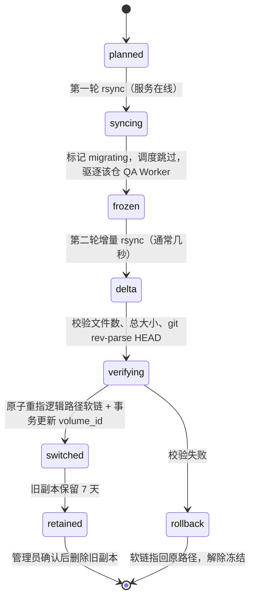
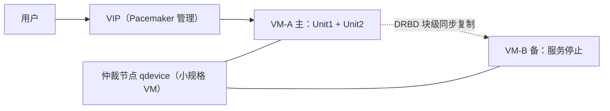
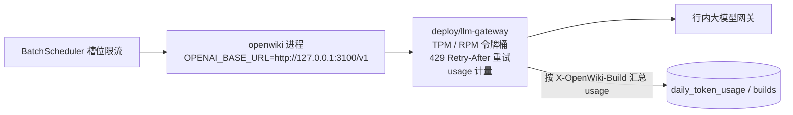

# 全行 633 仓基线批跑、多盘存储与组长权限体系实施计划（V7 私有云修正版）

> **For agentic workers:** REQUIRED SUB-SKILL: Use superpowers:subagent-driven-development (recommended) or superpowers:executing-plans to implement this plan task-by-task. Steps use checkbox (`- [ ]`) syntax for tracking.

**Goal:** 在**只改 `deploy/`、不改 OpenWiki 源码**的前提下，支撑全行 633 个仓库的基线批跑，具体包括：
- 真实 Token 采集与 TPM 防打穿；
- 多盘存储，并能均衡分布、平滑迁移；
- 业务聚合多仓（Virtual Monorepo）跨盘软链，且可在后台配置；
- 组长级权限体系；
- 私有云独立虚拟机的高可用。

**运行环境前提：** 行内私有云、独立虚拟机，**没有公有云磁盘漂移 API**。登录走行内 LDAP。

**Tech Stack:** Go（Unit 1 Orchestrator / Unit 2 Portal）、SQLite（WAL）、Vanilla JS、Linux（LVM / DRBD / Pacemaker 或虚拟化平台 HA）。

---

## 0. 本版修正说明（对照 V6 评审）

| # | V6 的问题 | V7 的处理 |
| :--- | :--- | :--- |
| 1 | Task 3 标记"已含 TPM"，实际没有 | 改为未完成；TPM 改由 **LLM Gateway**（Task 9）实现 |
| 2 | 说 `logrotate.conf` 已按 100MB 切割，实际只按天 | 改为未完成，并入 Task 13 |
| 3 | 说白天/夜间会自动切换并发，实际只有"夜间才开跑" | 改为未完成，并入 Task 9 的调度联动 |
| 4 | 说飞书导出有 10 个字段、带 BOM、按业务域统计，实际是 8 列、无 BOM、无业务域 | 改为未完成，并入 Task 21 |
| 5 | Node Hook 方案依赖 `NODE_OPTIONS`，openwiki 若是编译好的二进制就失效 | 改用 **base URL 指向本地 Gateway**（源码已支持 `OPENAI_BASE_URL` / `OPENAI_COMPATIBLE_BASE_URL` / `ANTHROPIC_BASE_URL`） |
| 6 | HA 写的是阿里云 Detach/Attach | 改为私有云方案：**虚拟化平台 HA 优先，DRBD + Pacemaker 兜底** |
| 7 | 声称 RPO=0，但 SQLite 没开 `synchronous=FULL` | Task 19 补上；RPO=0 只对**已提交事务**成立 |
| 8 | 按业务域固定分盘，会造成热点盘、容量倾斜 | 改为**容量 + 负载感知的加权放置**，业务域只作参考（见 §2） |
| 9 | 全量测试中 `internal/qa/TestManagerWorkerLifecycle` 失败（之前就有） | Task 8 的"全部 PASS"不成立；在 Task 22 单独跟踪 |

---

## 1. 目标存储拓扑

### 1.1 磁盘规划（单节点视角）

| 挂载点 | 规格（初始） | 内容 | 是否需要 HA 复制 |
| :--- | :--- | :--- | :--- |
| `/data/disk0` | 200GB SSD | `db/`（SQLite）、`static/`（633 仓可视化静态页，约 30GB）、`projects/`（虚拟 Monorepo）、`links/`（稳定路径层，见 §1.2） | ✅ 同步复制 |
| `/data/disk_log` | 100~200GB | `app/`、`builds/<batch_id>/`、`archive/`；挂载参数 `noatime` | ❌ 不复制，可直接清理 |
| `/data/vol1..volN` | 每块 500GB SSD，可随时加盘 | `repos/<repo_id>/`：源码、`.git`、`openwiki/` 文档、`.openwiki/` 状态 | ✅ 复制（生成的 wiki 文档花了 Token，不能丢） |

> 容量数字目前都是估算：单仓按 1GB、静态页按单仓 35MB 计。**Task 11 第一步要抽样 20 个代表仓库实测 `du`**，再按"峰值 × 1.5 / 70% 水位"定最终规格。

### 1.2 关键设计：稳定路径层（Stable Path Indirection）

所有对外引用的仓库路径都固定为**逻辑路径**，物理位置通过一层软链解析：

```
/data/openwiki/repos/<repo_id>   ──symlink──►   /data/vol2/repos/<repo_id>
        ▲  (repos.local_path 永远存这个)                 ▲ (repos.volume_id = vol2)
        │
/data/disk0/projects/<project_id>/<alias>  ──symlink──►  /data/openwiki/repos/<repo_id>
```

- `repos.local_path`、项目工作区软链、QA Worker 的 cwd，统一使用逻辑路径 `/data/openwiki/repos/<id>`。
- **迁移仓库只需原子地重指一条软链**（`ln -sfn` 写临时链 + `rename`），数据库里的路径和所有项目软链都不用改。
- 这一层同时解决了"历史数据平滑迁移"和"跨盘软链联动"两件事。
- ⚠️ 前置验证（Task 11 Step 1）：确认 openwiki CLI、git、QA daemon 在"路径本身是软链"时行为正常，尤其是 `.openwiki` 里是否持久化了 realpath。如果验证不通过，退回方案是把 `local_path` 存为物理路径，迁移时再批量调用 `PrepareWorkspace` 重建软链。

---

## 2. 多盘均衡算法：为什么不用令牌环（一致性哈希）

### 2.1 方案对比

| 维度 | 一致性哈希 / 令牌环 | **持久化映射 + 加权最少负载放置（采用）** |
| :--- | :--- | :--- |
| 查找方式 | 每次按 hash 计算 | 直接查 `repos.volume_id`（633 行，开销可忽略） |
| 仓库大小差异（50MB ~ 5GB+） | 不感知，按个数均分，**容量会倾斜** | 按实测 `size_bytes` 放置 |
| 盘大小不同 | 要靠虚拟节点权重近似 | 直接按 `capacity` 计算利用率 |
| 构建 I/O 热点 | 不感知 | 打分时计入该盘当前的活跃构建数 |
| 加新盘 | 自动迁走约 1/N 的数据，**时机不可控** | 生成迁移计划 → 人工审批 → 夜间限速执行 |
| 适用场景 | 节点频繁变化、无中心元数据的分布式 KV | **单机多盘、有中心数据库**（本场景） |

一致性哈希解决的是"没有中心元数据时如何定位数据"。我们已经有 SQLite，用它反而会丢掉对容量和负载的感知。

### 2.2 首次放置算法（新仓库导入时）

对每块 `status = active` 的盘 v 打分，选**分数最低**的：

$$
score(v) = 0.6 \cdot \frac{used_v + est}{cap_v} + 0.3 \cdot \frac{busy_v}{slots} + 0.1 \cdot \frac{n_v}{N}
$$

- `est`：新仓库的预估大小。同业务域有已知仓库就取其平均实测大小，否则取 1GB。
- `busy_v`：该盘当前正在构建的仓库数。
- `n_v / N`：该盘仓库数占比，用来打破平局。
- **硬约束**：放进去后利用率预计超过 80% 的盘直接排除；所有盘都超过时拒绝导入并告警。
- **业务域不再绑定到某块盘**。同域微服务分散在多块盘上，聚合问答时 I/O 正好并行（§3）。
- 首次 clone 完成后，后台任务用 `du` 回填 `repos.size_bytes`，之后每天刷新一次。

### 2.3 再均衡（Rebalance）

- **触发条件**：任意两块盘利用率相差超过 15%，或任一盘超过 80%，或新加了盘。
- **生成计划**（贪心）：反复从利用率最高的盘挑一个"冷"仓库（7 天内没构建、不在运行中的批次里），迁到利用率最低且放得下的盘，直到最大差值小于 5%。优先挑大仓库，以减少迁移次数。
- **执行**：计划在后台展示，审批后进入迁移队列，只在夜间窗口执行；`rsync --bwlimit` 限速，与构建共用全局槽位，避免抢 I/O。

---

## 3. 历史数据平滑迁移

### 3.1 现状 → 目标

| 数据 | 现状（以现网 config 为准） | 目标 |
| :--- | :--- | :--- |\
| 仓库 | `ReposBaseDir/<id>`，单盘实体目录 | `/data/volN/repos/<id>` + 逻辑路径软链 |
| 静态页 | `StaticOutputDir` | `/data/disk0/static` |
| 项目工作区 | `ProjectsBaseDir`，软链指向旧仓库路径 | `/data/disk0/projects`，软链指向逻辑路径 |
| 数据库 | `DBPath` | `/data/disk0/db/orchestrator.db` |
| 日志 | `/data/openwiki/logs` | `/data/disk_log` |

### 3.2 单仓在线迁移状态机（每个仓库独立、可回滚）



- 单个仓库的不可用时间只有 `frozen → switched` 这一段，一般在秒级；其他仓库不受影响。
- 迁移任务持久化在 `volume_migrations` 表里，进程重启后能从当前状态继续。
- **删除旧副本必须管理员二次确认**，不做自动删除。

### 3.3 一次性步骤（需要短暂停机窗口，约 10 分钟）

1. 用 `sqlite3 .backup` 做全量备份，并校验 `PRAGMA integrity_check`。
2. 执行 schema 迁移（幂等）：新增 `volumes`、`volume_migrations`、`repos.volume_id`、`repos.size_bytes`。
3. 把数据库移到 `disk0/db`，静态页移到 `disk0/static`，更新 config 路径。
4. **原地纳管**：现有 `ReposBaseDir` 所在的盘登记为 `vol0`。每个仓库目录在本盘内 `mv` 到 `vol0/repos/<id>`（同盘 rename，瞬间完成），原位置改为软链。所有 `local_path` 统一改写为逻辑路径，然后批量调用 `PrepareWorkspace` 重建项目软链。
5. 启动服务后，再通过 §2.3 的再均衡**在线、逐步**把仓库从 `vol0` 迁往新盘，不需要额外停机。

工具：`deploy/scripts/openwiki-migrate`（Go 子命令），支持 `plan`（只出计划）、`apply`、`status`、`rollback <repo_id>`。

---

## 4. 用户与权限体系（RBAC，含组长）

### 4.1 角色与授权范围

| 角色 | 授权范围 | 能做什么 |
| :--- | :--- | :--- |
| `super_admin` 系统管理员 | 全局 | 磁盘与迁移、LLM Gateway 限额、用户授权、日志清理、全部报表 |
| `group_leader` **组长** | 一个或多个**业务域**（可另加指定项目） | 在授权域内：创建/编辑项目、选择和移除子仓库、设置别名与角色、触发构建、查看本域 Token 报表 |
| `member` 普通成员 | 已授权项目（默认可读全部） | 浏览 Wiki、问答 |

- 身份认证继续用 LDAP。角色与范围由**数据库授权**决定，不再只依赖 config 里的 `admin_users`。
- `admin_users` 保留为**引导 / 应急超管**（break-glass），保证数据库授权出问题时仍能登录。
- 组长不能跨域操作：给项目添加的仓库，`business_domain` 必须在其授权范围内。

### 4.2 数据模型（Portal 库）

```sql
users(user_id PK, display_name, status, last_login_at, created_at)
user_roles(id PK, user_id, role, scope_type /* global|domain|project */, scope_value, granted_by, created_at)
audit_logs(id PK, user_id, action, target_type, target_id, detail_json, ip, created_at)
```

### 4.3 鉴权链路

1. **Portal 是唯一的鉴权点**：每个 `/portal/*` 写接口先做 `RequirePermission(action, resource)`。项目操作会解析出项目所含仓库的业务域，再和用户授权范围比对。
2. Portal 调用 Orchestrator 时附带 `X-OpenWiki-User`、`X-OpenWiki-Role`，以及用共享密钥计算的 `X-OpenWiki-Sig`（HMAC）。Orchestrator 验签后才接受请求，并写审计日志。Orchestrator 只监听内网 / 本机地址。
3. 所有写操作（项目变更、授权、迁移、清理）都写入 `audit_logs`，后台可以查询。

---

## 5. 后台管理设计（运维视角）

| 页面 | 谁能用 | 核心功能 |
| :--- | :--- | :--- |
| **我的业务域**（组长首页） | 组长 | 只显示授权域内的项目和仓库；构建状态、Token 用量 |
| **项目工作区配置** | 组长 / 超管 | 见 §5.1 |
| **存储与磁盘** | 超管 | 每块盘的容量、利用率、仓库数、活跃构建数；新增盘、状态切换（active / draining / readonly）；再均衡计划预览与审批 |
| **迁移中心** | 超管 | 迁移队列与单仓状态机进度；暂停 / 继续；单仓回滚；旧副本确认删除 |
| **用户与权限** | 超管 | 按 LDAP 账号搜索用户 → 授予组长并勾选业务域；撤销；查看审计日志 |
| **算力与限流** | 超管 | Gateway 的 TPM / RPM 上限、白天 / 夜间并发；429 次数实时曲线 |
| **日志** | 超管 | `disk_log` 使用率；按天数或批次清理（二次确认） |
| **报表** | 组长（本域）/ 超管 | Token 日报；飞书 TSV 复制、CSV 下载 |

### 5.1 业务聚合多仓（跨盘软链）的配置流程

1. 组长新建项目，填写 ID、名称、描述。
2. 仓库选择器只列出授权域内的仓库，支持搜索和按 Tier 筛选；为每个子仓库设置别名（`alias`）和角色（gateway / service / lib）。
3. **软链预览**：保存前展示目录树和每条链的解析结果：
   ```
   finance-domain/
   ├── trade-gateway  → /data/openwiki/repos/trade-gateway  → vol1  ✅
   ├── payment-core   → /data/openwiki/repos/payment-core   → vol2  ✅
   └── risk-eval      → /data/openwiki/repos/risk-eval      → vol3  ⚠️ 未构建
   ```
   同时显示子仓库在各盘上的分布，便于看出聚合问答的 I/O 是否分散。
4. 保存后调用 `PrepareWorkspace`，写审计日志，并重启该项目的 QA Worker。
5. **健康巡检**：每天检测所有项目软链，标记断链、目标不存在、仓库迁移中等情况。后台提供"一键修复"，即对该项目重新执行 `PrepareWorkspace`。

---

## 6. 私有云高可用（独立虚拟机）

### 6.1 方案 A（优先）：虚拟化平台 HA

如果行内私有云是 VMware vSphere、华为 FusionCompute、SmartX、OpenStack（Masakari）等，并且数据盘放在**共享存储**（SAN 或分布式存储）上：

- 开启平台的 VM HA。宿主机故障时，VM 会在其他宿主机上自动重启，磁盘保持原样挂载。
- **应用零改动**，RTO 约 3~5 分钟。
- 只覆盖宿主机故障，不覆盖虚拟机内部的系统损坏，所以仍需配合 §6.3 的备份。

### 6.2 方案 B（平台不支持 HA 或没有共享存储时）：双机 DRBD + Pacemaker



- 每台 VM 都有自己的本地盘（保持"硬挂载"）。通过 DRBD 把 `disk0`、`vol*` 做块级复制：`disk0` 用 **Protocol C（同步）**，`vol*` 可用 Protocol C，或在带宽紧张时用 A。`disk_log` 不复制。
- Pacemaker 资源组的启动顺序：DRBD 提升为主 → 挂载文件系统 → 启动 Orchestrator → 启动 Portal → 绑定 VIP。
- **必须配置 Fencing**（`fence_vmware_rest`、`fence_ipmilan` 或 SBD）和**第三方仲裁 qdevice**，防止双主脑裂。
- RTO 约 1~2 分钟。对已提交事务 RPO = 0，前提是 Task 19 的 `synchronous=FULL` 已开启。
- 代价：存储翻倍，备机需要相同规格的磁盘。

### 6.3 两种方案都要做

- SQLite 每小时用 `.backup` 备份到另一台机器或 NAS，保留 7 天；`static/` 每天增量 rsync 一次。
- 服务启动时，把批次里所有 `running` 状态的任务重置为 `pending`（Task 19）。

> 需要行内基础设施团队确认：虚拟化平台类型、是否有共享存储、能否分配 VIP、可用的 Fencing 方式。

---

## 7. LLM Gateway：TPM 防打穿 + 真实 Token 采集（零侵入）



- **双桶限流**：RPM 桶按请求数扣减；TPM 桶请求前按 `max_tokens` 加输入长度 / 4 预扣，响应后用真实 `usage` 多退少补。额度不足时请求**在网关内排队**，不会把 429 抛给 openwiki。
- **429 处理**：优先读 `Retry-After` 或 `x-ratelimit-reset-tokens`，否则指数退避加随机抖动（5s → 60s）。连续 429 时通知调度器把并发降一档；连续 10 分钟健康后再升回去。
- **用量归属**：调度器给每个构建分配一个 token（通过 API Key 后缀或独立端口区分），网关据此把用量记到对应的 build 和 repo 上，**不再依赖解析 stdout**。
- **协议范围**：首期支持 OpenAI 兼容协议（含流式 SSE 的 `usage` 字段）。如果行内模型是 Anthropic 原生协议，再补一个适配器。

---

## 8. 实施任务

### 已完成（保留）

- [x] **Task 2** 数据库批跑表与基线字段（`306e818`）
- [x] **Task 3a** 槽位并发限流 `DynamicRateLimiter` / `SlotPool`（`1d17cc1`）。⚠️ 不含 TPM
- [x] **Task 4** 统一流水线与 BatchScheduler（`421f91a`）
- [x] **Task 5** 批量导入与业务域聚合 API（`40f9961`）
- [x] **Task 6** Portal 反代（`1239432`）
- [x] **Task 7** 批跑看板（`3ea360b`）
- [x] **Task 8** 打包与部署脚本（`6e9121b`、`4ef51c1`、`f1cc6ab`）。⚠️ 全量测试不是全部 PASS，见 Task 22

### 需返工

- [ ] **Task 1′ 还原 OpenWiki 源码改动**
  - Revert：`src/agent/index.ts`、`test/agent/usage_telemetry.test.ts`
  - 先验证：去掉 `src/cli/cli.tsx` 和 `vfs-polyfill.ts` 的改动后 CLI 能否编译运行。如果不能，改由 `deploy/unit1-orchestrator/scripts/json-import-shim.mjs` 兜底，并在 Builder 中保证注入
  - 验证：`git diff origin/feat/virtual-project-workspace..HEAD -- src test` 输出为空

### 阶段一：算力

- [ ] **Task 9 LLM Gateway**：新建 `deploy/llm-gateway/`（Go）
  - 测试 `TestTPMBucketBlocksWhenExhausted`、`TestRetryAfterHonored`、`TestStreamingUsageAccounting`、`TestPerBuildAttribution`（用 httptest 模拟上游）
  - Builder 注入 `OPENAI_BASE_URL` / `OPENAI_COMPATIBLE_BASE_URL` 指向网关
  - 调度联动：429 降并发、白天 / 夜间自动切换并发上限（`TestDayNightConcurrencySwitch`）
- [ ] **Task 10 Token 采集切换到网关**：`pipeline.go` 的 Token 来源改为网关汇总；`ParseTokenUsage` 保留作兜底；`builds` 表新增 `rate_limited_retries` 字段

### 阶段二：存储

- [ ] **Task 11 磁盘与放置**
  - Step 1：在测试环境验证逻辑路径软链下 openwiki / git / QA daemon 行为正常，并实测 20 个仓库的大小
  - 新增 `volumes` 表、`repos.volume_id` / `size_bytes`，以及 `internal/storage/placement.go`
  - 测试 `TestPlacementPrefersLowestScore`、`TestPlacementRejectsAbove80Percent`、`TestPlacementUsesDomainAvgSize`
  - 批量导入改为调用放置算法，并创建逻辑路径软链
- [ ] **Task 12 迁移引擎**：`internal/storage/migrate.go` 实现单仓状态机，`volume_migrations` 持久化，再均衡计划器，`openwiki-migrate` 子命令
  - 测试 `TestMigrateHappyPath`、`TestMigrateRollbackOnVerifyFail`、`TestMigrateResumeAfterRestart`、`TestRebalancePlanConverges`
  - QA Manager 新增 `Evict(repoID)`
- [ ] **Task 13 目录迁移与日志**：一次性迁移脚本（§3.3），把 config 路径改到 `disk0` 和 `disk_log`；`logrotate.conf` 改为 `/data/disk_log/**/*.log`，`daily + maxsize 100M + rotate 14`

### 阶段三：权限

- [ ] **Task 14 RBAC 数据层**：Portal 库新增 `users`、`user_roles`、`audit_logs`；登录时同步用户并加载角色；`admin_users` 作为应急超管
  - 测试 `TestLeaderScopeByDomain`、`TestBreakGlassAdmin`
- [ ] **Task 15 鉴权与签名**：实现 `RequirePermission` 中间件；Portal → Orchestrator 的 HMAC 头；Orchestrator 验签并写审计
  - 测试 `TestLeaderCannotEditOtherDomain`、`TestUnsignedRequestRejected`

### 阶段四：后台

- [ ] **Task 16 存储与迁移中心页面**（Portal `admin.html` 新增两个 Tab，加对应 API）
- [ ] **Task 17 项目工作区配置**：仓库选择器、软链预览 API（`GET /portal/projects/{id}/links/preview`）、健康巡检与一键修复
- [ ] **Task 18 用户与权限页面**：LDAP 搜索、授予组长和业务域、审计日志查询；新增"我的业务域"首页

### 阶段五：可靠性与报表

- [ ] **Task 19 SQLite 与启动恢复**：DSN 加 `_synchronous=FULL`；启动时把批次中的 `running` 重置为 `pending`（`TestRecoverRunningTasksOnStartup`）；每小时备份脚本
- [ ] **Task 20 HA 落地**：按基础设施团队的确认结果选方案 A 或 B。方案 B 需交付 `deploy/ha/` 下的 DRBD 资源配置、Pacemaker CRM 配置、Fencing 示例，以及 `RUNBOOK_HA.md`（含切换演练步骤）
- [ ] **Task 21 飞书导出补齐**：CSV 加 BOM；`daily_token_usage` 增加 `business_domain` 维度（主键改为 `date + domain`，需迁移旧数据）；补上限流重试次数、平均耗时两列，与 §8 字段字典一致

### 阶段六：验收

- [ ] **Task 22 测试环境端到端验收**：用 20 个样本仓库 + 2 块数据盘走完全流程：导入 → 放置 → 批跑 → 迁移 → 回滚 → 组长配置项目 → HA 切换演练。修复或明确隔离 `TestManagerWorkerLifecycle`

---

## 9. 飞书多维表格字段字典（Task 21 交付标准）

| 字段 | 类型 | 说明 |
| :--- | :--- | :--- |
| 统计日期 | 日期 | |
| 业务域 | 单选 | |
| 构建成功仓数 / 增量跳过仓数 | 数字 | |
| 总Token / PromptToken / CompletionToken | 数字 | 来自 Gateway 实测 |
| 节约Token估算 | 数字 | 跳过仓数 × 该仓历史平均 Token |
| 模型限流重试次数 | 数字 | 来自 Gateway |
| 平均单仓耗时(秒) | 数字 | |

TSV 用 `\t` 分隔列、`\r\n` 分隔行，前端复制到剪贴板；CSV 带 UTF-8 BOM。

---

## 10. 待确认事项

1. 私有云虚拟化平台类型、是否有共享存储、能否分配 VIP、Fencing 方式（决定 Task 20 走 A 还是 B）。
2. 行内大模型网关的协议（OpenAI 兼容还是其他），以及账号的 TPM / RPM 配额。
3. 组长的授权粒度：只按业务域，还是也要按单个项目？
4. 现网实际路径（`ReposBaseDir`、`StaticOutputDir`、`DBPath`），用于定制一次性迁移脚本。
